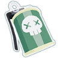

This is my first mod. It's fairly small and simple.  
It adds 4 new items and 1 equipment to the game.
 
 
| What it look like  | What it do|
| ------------- | ------------- |
| | 
**ITEMS**
 |
|  | **Stinky Bomb** Chance on hit to poison surrounding enemies. |
|  | **Liquid Nitrogen** Killing an enemy slows surrounding enemies, with a chance to cause a freezing blast instead. |
|  | **Death's Doorhandle** Falling below half health increases movement speed, attack speed and chance to crit. |
|  | **Champion Fungus** Killing an enemy heals you for a percentage of the damage done. |
| | 
**EQUIPMENT**
 |
|  | **Stone Gauntlet** Unleash titanic wrath. |

If you notice something's screwy or think something is wildly unbalanced you can let me know in the modding discord server.

## Thanks to

- Myself, for actually finishing something for once

- Bigrock, for giving me some ideas

- The modding discord, for answering my dumbass questions